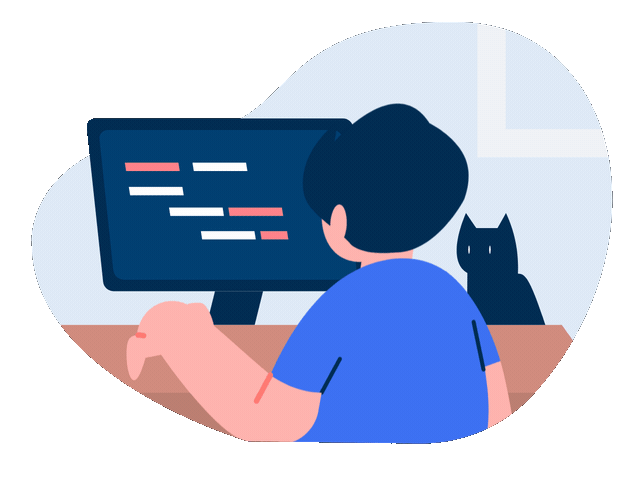

  <picture>
    <source media="(max-width: 600px) and (prefers-color-scheme: dark)" srcset="./assets/hero-mobile-dark.svg">
    <source media="(max-width: 600px)" srcset="./assets/hero-mobile-light.svg">
    <source media="(prefers-color-scheme: dark)" srcset="./assets/hero-dark.svg">
    
  </picture>

  
  &nbsp;
  
  &nbsp;
  

  <a href="#sobre-mim"><kbd>sobre mim</kbd></a> &nbsp;
  <a href="#dados-no-dia-a-dia"><kbd>dados</kbd></a> &nbsp;
  <a href="#projetos-em-destaque"><kbd>projetos</kbd></a> &nbsp;
  <a href="#stack"><kbd>stack</kbd></a> &nbsp;
  <a href="#github"><kbd>github</kbd></a>

## Sobre mim

Sou **Carlos Leonel**, desenvolvedor de software direcionando minha carreira para **Engenharia de Dados**. Tenho experiência prática com **Python, PySpark, Palantir Foundry e integração com SAP**.

Minha base em **backend, APIs e modelagem relacional** conecta a construção de aplicações ao tratamento dos dados que elas produzem e consomem. Curso **Desenvolvimento de Software Multiplataforma na Fatec**, em São Paulo.

## Dados no dia a dia

<picture>
  <source media="(max-width: 600px) and (prefers-color-scheme: dark)" srcset="./assets/pipeline-mobile-dark.svg">
  <source media="(max-width: 600px)" srcset="./assets/pipeline-mobile-light.svg">
  <source media="(prefers-color-scheme: dark)" srcset="./assets/pipeline-dark.svg">
  
</picture>

- **Ingestão e transformação:** tratamento e cruzamento de bases com Python e PySpark no Palantir Foundry, com validação de dados do SAP.
- **Automação:** extração de informações com Selenium e desenvolvimento de fluxos com Power Automate e SharePoint.
- **Modelagem:** SQL, organização de dados relacionais e integração entre sistemas.

## Projetos em destaque

<table>
<tr>
<td width="50%" valign="top">

<a href="https://github.com/anunci-ai/api">
<picture>
  <source media="(prefers-color-scheme: dark)" srcset="./assets/project-anuncia-dark.svg">
  
</picture>
</a>

**SaaS para criação de anúncios de e-commerce com IA, desenvolvido em equipe.**

Atuei no backend com Clean Architecture e DDD, login social com Google OAuth e fluxos de upload e gerenciamento de imagens no Cloudflare R2.

`TypeScript` `Express` `PostgreSQL` `Prisma` `R2` `QStash`

**[Explorar a API ↗](https://github.com/anunci-ai/api)**

</td>
<td width="50%" valign="top">

<a href="https://github.com/Proj-Smart-Barber/api">
<picture>
  <source media="(prefers-color-scheme: dark)" srcset="./assets/project-smartbarber-dark.svg">
  
</picture>
</a>

**Plataforma em equipe para conectar clientes, barbearias e profissionais.**

A API organiza serviços, disponibilidade e agendamentos com entidades de domínio, casos de uso, persistência relacional e testes.

`TypeScript` `Express` `PostgreSQL` `Drizzle` `Vitest`

**[API ↗](https://github.com/Proj-Smart-Barber/api)** · **[Frontend ↗](https://github.com/Proj-Smart-Barber/Smart-Barber-frontend-mobile-web)**

</td>
</tr>
<tr>
<td width="50%" valign="top">

<a href="https://github.com/Carlos-Leon3l/Lista-de-tarefas-pessoal">
<picture>
  <source media="(prefers-color-scheme: dark)" srcset="./assets/project-fastapi-dark.svg">
  
</picture>
</a>

**Aplicação full stack de gerenciamento de tarefas.**

Cadastro e login com JWT, operações de tarefas por usuário e integração entre uma interface React, uma API Python e Oracle Database.

`Python` `FastAPI` `React` `Oracle` `JWT`

**[Explorar o projeto ↗](https://github.com/Carlos-Leon3l/Lista-de-tarefas-pessoal)**

</td>
<td width="50%" valign="top">

<a href="#dados-no-dia-a-dia">
<picture>
  <source media="(prefers-color-scheme: dark)" srcset="./assets/project-dados-dark.svg">
  
</picture>
</a>

**Experiência profissional · Desenvolvimento e Dados.**

Processamento e transformação com Python e PySpark, integração de bases no Foundry e automação de extração. A prática que orienta minha evolução em Engenharia de Dados.

`Python` `SQL` `PySpark` `Foundry` `Selenium`

**[Conhecer minha trajetória ↗](https://www.linkedin.com/in/carlos-leonel-a3601733a/)**

</td>
</tr>
</table>

## Stack

<table>
<tr>
<td width="50%" valign="top">

### Dados e modelagem

<picture>
  <source media="(prefers-color-scheme: dark)" srcset="./assets/stack-data-dark.svg">
  
</picture>
<a href="https://www.palantir.com/platforms/foundry/">
<picture>
  <source media="(prefers-color-scheme: dark)" srcset="./assets/foundry-dark.svg">
  
</picture>
</a>

**Python · SQL · PySpark · Pandas** 
**Palantir Foundry** · PostgreSQL · Oracle SQL · MySQL 
ETL/ELT · Modelagem relacional

</td>
<td width="50%" valign="top">

### Backend e integrações

<picture>
  <source media="(prefers-color-scheme: dark)" srcset="./assets/stack-backend-dark.svg">
  
</picture>

**TypeScript · Node.js · FastAPI · Django** 
Express · Prisma · APIs REST 
Clean Architecture · DDD

</td>
</tr>
<tr>
<td width="50%" valign="top">

### Interfaces

<picture>
  <source media="(prefers-color-scheme: dark)" srcset="./assets/stack-frontend-dark.svg">
  
</picture>

**React · React Native** 
Interfaces web e mobile · Integração com APIs

</td>
<td width="50%" valign="top">

### Ferramentas e entrega

<picture>
  <source media="(prefers-color-scheme: dark)" srcset="./assets/stack-tools-dark.svg">
  
</picture>

**Git · GitHub · Docker · Vitest** 
Versionamento · Containers · Testes

</td>
</tr>
</table>

Outras ferramentas e integrações

Selenium · Power Automate · SharePoint · Cloudflare R2 · Upstash QStash

## GitHub

<picture>
  <source media="(prefers-color-scheme: dark)" srcset="https://github-profile-summary-cards.vercel.app/api/cards/stats?username=Carlos-Leon3l&amp;theme=github_dark">
  
</picture>
<picture>
  <source media="(prefers-color-scheme: dark)" srcset="https://github-profile-summary-cards.vercel.app/api/cards/most-commit-language?username=Carlos-Leon3l&amp;theme=github_dark">
  
</picture>

<a href="https://github.com/Carlos-Leon3l?tab=overview">Ver meu perfil e minhas contribuições no GitHub ↗</a>

 

<a href="https://www.linkedin.com/in/carlos-leonel-a3601733a/">
<picture>
  <source media="(prefers-color-scheme: dark)" srcset="./assets/footer-dark.svg">
  
</picture>
</a>

<b><a href="https://www.linkedin.com/in/carlos-leonel-a3601733a/">LinkedIn ↗</a></b> &nbsp; · &nbsp; <b><a href="mailto:carlos.leonel268@gmail.com">carlos.leonel268@gmail.com</a></b>

Ilustração: <a href="https://lottiefiles.com/free-animation/young-programmers-working-with-computer-b46FFl7pVr">Abdul Latif / LottieFiles</a>.

